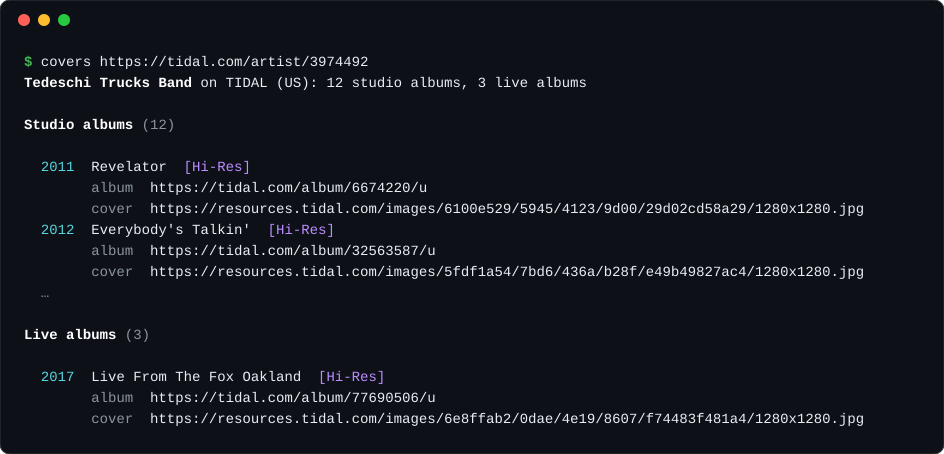

<div align="center">

# album-covers

**Every album by an artist, with links to the album and its full-size cover art.**

Paste a TIDAL or Spotify artist link and get a clean, chronological discography in your terminal.

[](https://github.com/zunhdev/album-covers/actions/workflows/ci.yml)
[](https://deps.rs/repo/github/zunhdev/album-covers)
[](https://www.rust-lang.org)
[](#license)
<br>
[](#get-tidal-credentials)
[](#get-spotify-credentials)
[](#install)

<br>



[Install](#install) · [Set up](#set-up-once) · [Usage](#usage) · [Output](#output) · [Troubleshooting](#troubleshooting)

</div>

## Highlights

- **One link in, the whole discography out.** Copy an artist link from the TIDAL or Spotify app's
  *Share* menu, or from the browser's address bar.
- **The biggest cover there is:** 1280×1280 pixels on TIDAL, 640×640 on Spotify.
- **A list worth reading.** Studio and live albums are listed separately, duplicate editions are
  dropped, and albums the artist only guests on are left out.
- **EPs, singles and compilations** on request.
- **Made for scripts too.** `--json` prints one clean document; pipe it into `jq`, `curl`, or
  anything else.
- **Fast and friendly.** A single small binary with no runtime, clear error messages, and patient
  handling of rate limits.

## Quick start

```sh
cargo install --locked --git https://github.com/zunhdev/album-covers   # 1. install
# 2. save your TIDAL or Spotify credentials (see "Set up" below)
covers https://tidal.com/artist/3974492                                # 3. go
```

## Install

`covers` is written in Rust. If you don't have Rust yet, get it from [rustup.rs](https://rustup.rs)
(one command, no admin rights needed). Then:

```sh
cargo install --locked --git https://github.com/zunhdev/album-covers
```

This builds the `covers` command and puts it in `~/.cargo/bin`, which the Rust installer already
added to your `PATH`. Run the same command again to update.

## Set up (once)

`covers` uses the services' official APIs, which need a free *developer app*. It takes a couple
of minutes to create one, and you only need it for the service you use.

### Get TIDAL credentials

1. Sign in at [developer.tidal.com/dashboard](https://developer.tidal.com/dashboard) with your
   TIDAL account.
2. Create an app. Any name will do.
3. Copy the app's **Client ID** and **Client Secret**.

### Get Spotify credentials

1. Sign in at [developer.spotify.com/dashboard](https://developer.spotify.com/dashboard).
2. Create an app. Any name and description will do. Spotify also asks for a redirect URI, which
   `covers` doesn't use: enter `http://127.0.0.1:8888/callback`. Select **Web API**.
3. In the app's settings, copy the **Client ID** and **Client Secret**.

> [!NOTE]
> Since February 2026, Spotify only answers apps whose owner has a **Spotify Premium**
> subscription. Without it, `covers` reports `Spotify answered HTTP 403`. TIDAL has no such
> requirement.

### Save them

Put the credentials in a file named `credentials.env` in the config folder:

| System          | File                                             |
| --------------- | ------------------------------------------------ |
| macOS and Linux | `~/.config/album-covers/credentials.env`         |
| Windows         | `%APPDATA%\album-covers\credentials.env`         |

On macOS and Linux:

```sh
mkdir -p ~/.config/album-covers
cat > ~/.config/album-covers/credentials.env <<'EOF'
TIDAL_CLIENT_ID=paste-your-client-id-here
TIDAL_CLIENT_SECRET=paste-your-client-secret-here
EOF
chmod 600 ~/.config/album-covers/credentials.env   # readable only by you
```

For Spotify, add `SPOTIFY_CLIENT_ID=…` and `SPOTIFY_CLIENT_SECRET=…` lines the same way.

> [!TIP]
> You can also use environment variables, or a `.env` file in the folder you run `covers` from.
> When a value is set in more than one place, environment variables win over `.env`, and `.env`
> wins over the config file.

## Usage

```sh
covers [OPTIONS] <ARTIST_LINK>
```

| To…                             | Run                                                              |
| ------------------------------- | ---------------------------------------------------------------- |
| list the albums                 | `covers https://tidal.com/artist/3974492`                        |
| also list EPs and singles       | `covers --include eps,singles https://tidal.com/artist/3974492`  |
| list everything                 | `covers --include all https://tidal.com/artist/3974492`          |
| use another country's catalog   | `covers --country DE https://tidal.com/artist/3974492`           |
| save the list to a file         | `covers https://tidal.com/artist/3974492 > albums.txt`           |
| get JSON for a script           | `covers --json https://tidal.com/artist/3974492`                 |

### Options

| Option                  | What it does                                                                     |
| ----------------------- | -------------------------------------------------------------------------------- |
| `-i, --include <TYPES>` | Also list `eps`, `singles`, `compilations` (Spotify only), or `all`. Separate several with commas. |
| `-c, --country <CODE>`  | Use another country's catalog, as a two-letter code like `DE` or `GB`. Default: `US`. |
| `--json`                | Print JSON instead of text (same as `--format json`).                            |
| `-q, --quiet`           | Print only the albums: no progress or summary.                                   |
| `--color <WHEN>`        | `auto` (default), `always` or `never`. `NO_COLOR` is honored too.                |
| `-h, --help`            | Show help.                                                                       |
| `-V, --version`         | Show the version.                                                                |

### Artist links

Any of these work. Anything after `?`, like Spotify's `?si=…`, is ignored.

```text
https://tidal.com/artist/3974492            https://open.spotify.com/artist/4Z8W4fKeB5YxbusRsdQVPb
https://tidal.com/artist/3974492/u          https://open.spotify.com/intl-de/artist/4Z8W4fKeB5YxbusRsdQVPb
https://tidal.com/browse/artist/3974492     spotify:artist:4Z8W4fKeB5YxbusRsdQVPb
https://listen.tidal.com/artist/3974492
```

### Recipes

**Download every cover** as `YEAR - Title.jpg`, with [jq](https://jqlang.org) and curl:

```sh
covers --json https://tidal.com/artist/3974492 |
  jq -r '.albums[] | [.cover.url, "\(.release_date[:4]) - \(.title | gsub("/"; "-")).jpg"] | @tsv' |
  while IFS=$'\t' read -r url file; do curl -sSfL "$url" -o "$file"; done
```

**Just the cover links:**

```sh
covers --json https://tidal.com/artist/3974492 | jq -r '.albums[].cover.url'
```

**Only the live albums:**

```sh
covers --json https://tidal.com/artist/3974492 | jq -r '.albums[] | select(.category == "live_album") | .title'
```

## Output

In text mode, a one-line summary goes to stderr and the albums to stdout, so
`covers … > albums.txt` saves just the list. Albums are grouped (studio albums, live albums, EPs,
singles, compilations) and sorted by release date.

<details>
<summary><b>JSON format</b></summary>

<br>

`--json` prints one document. `category` is one of `studio_album`, `live_album`, `ep`, `single`
or `compilation`. A cover's `width` and `height` are `null` when the service doesn't report them.

```json
{
  "provider": "tidal",
  "country": "US",
  "artist": { "id": "3974492", "name": "Tedeschi Trucks Band", "url": "https://tidal.com/artist/3974492/u" },
  "albums": [
    {
      "title": "Revelator",
      "release_date": "2011-06-07",
      "category": "studio_album",
      "url": "https://tidal.com/album/90411175/u",
      "cover": { "url": "https://resources.tidal.com/images/b0d76555/a1cf/41f3/97da/e9b8b3a72af6/1280x1280.jpg", "width": 1280, "height": 1280 }
    }
  ]
}
```

</details>

<details>
<summary><b>Exit codes</b></summary>

<br>

| Code | Meaning                                                   |
| ---- | --------------------------------------------------------- |
| `0`  | Success, including "nothing found"                        |
| `1`  | Something went wrong while fetching (credentials, network, service error) |
| `2`  | The command line or the link is wrong                     |

</details>

## Troubleshooting

<details>
<summary><b><code>missing TIDAL credentials</code></b></summary>

<br>

`covers` didn't find the client ID or secret. The message names the file it looked for; see
[Set up](#set-up-once).

</details>

<details>
<summary><b><code>… did not accept the client credentials</code></b></summary>

<br>

Check the values for typos, missing characters, or extra spaces.

</details>

<details>
<summary><b><code>Spotify answered HTTP 403</code></b></summary>

<br>

The Spotify app's owner needs Spotify Premium (see the note in [Set up](#get-spotify-credentials)).

</details>

<details>
<summary><b><code>rate limited, retrying in 4s</code></b></summary>

<br>

TIDAL limits how fast apps may ask. This happens with artists who have hundreds of releases, or
when you run `covers` several times in a row. It waits and carries on by itself.

</details>

<details>
<summary><b>An album is missing</b></summary>

<br>

Catalogs differ by country; try `--country` with your own country code. Also, when the same album
is listed several times on the same day (say, "Night Drive" and "Night Drive (Deluxe)"), only the
first one is kept.

</details>

<details>
<summary><b>A studio album is listed as live, or the other way around</b></summary>

<br>

Live albums are recognized by their titles: words like *Live*, *Unplugged*, *In Concert* or
*Sessions*. A studio album called "Live Through This" will be listed as live.

</details>

<details>
<summary><b>On Spotify, a single shows up as an EP</b></summary>

<br>

Spotify labels EPs as singles, so `covers` treats a "single" with four or more tracks as an EP, as
Spotify's own guidelines do.

</details>

<details>
<summary><b>It hangs the first time</b></summary>

<br>

A firewall such as Little Snitch may be waiting for you to allow `covers` to connect. Allow
`auth.tidal.com` and `openapi.tidal.com` (TIDAL), or `accounts.spotify.com` and `api.spotify.com`
(Spotify).

</details>

## Contributing

Bug reports, ideas and pull requests are welcome. [CONTRIBUTING.md](CONTRIBUTING.md) explains how
the code is organized and how to run the checks. Please report security issues privately, as
described in [SECURITY.md](SECURITY.md).

## License

Licensed under either of [Apache License, Version 2.0](LICENSE-APACHE) or [MIT license](LICENSE-MIT)
at your option.

Unless you explicitly state otherwise, any contribution intentionally submitted for inclusion in
this project by you, as defined in the Apache-2.0 license, shall be dual licensed as above, without
any additional terms or conditions.

---

<sub>album-covers is not affiliated with, endorsed or sponsored by TIDAL or Spotify. It uses their
public developer APIs and only links to cover art, which belongs to its respective rights holders.</sub>
